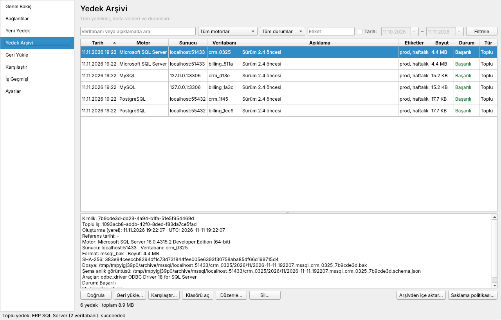
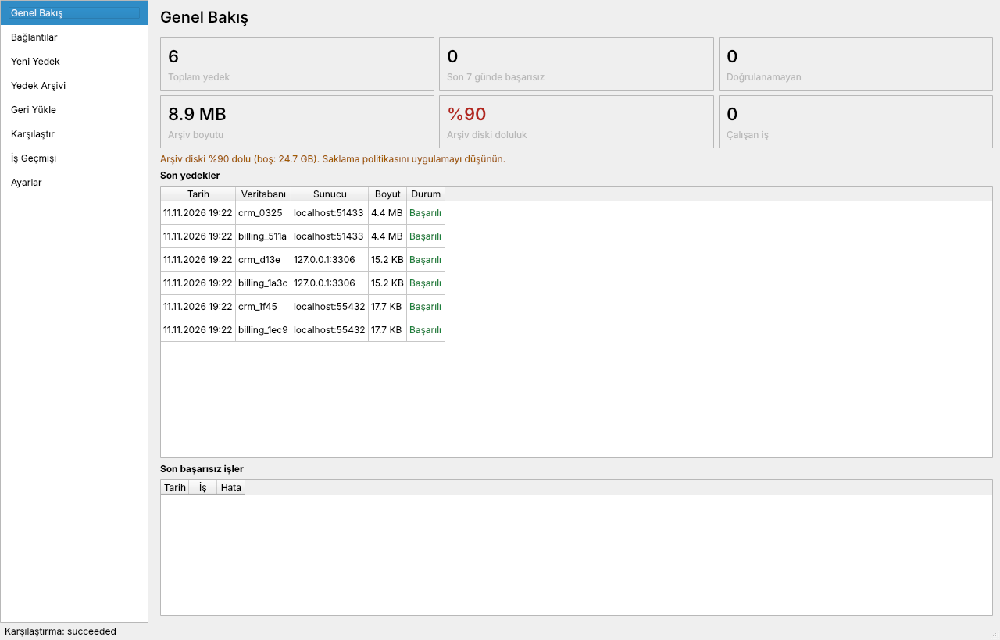
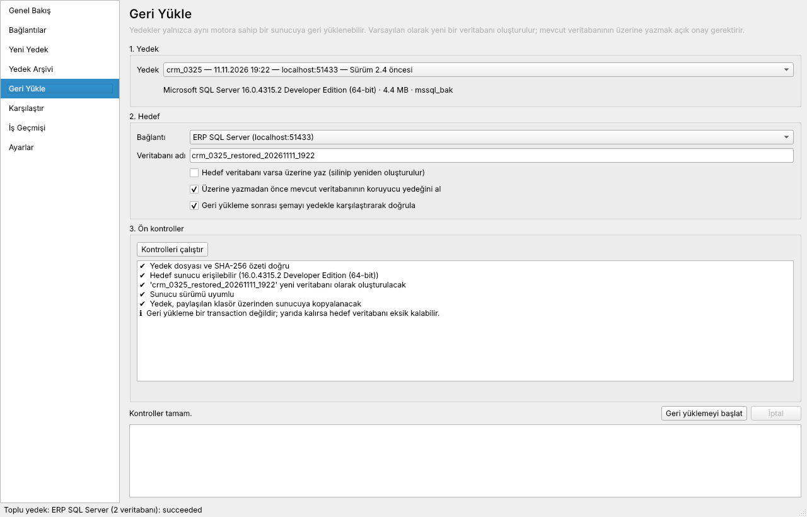
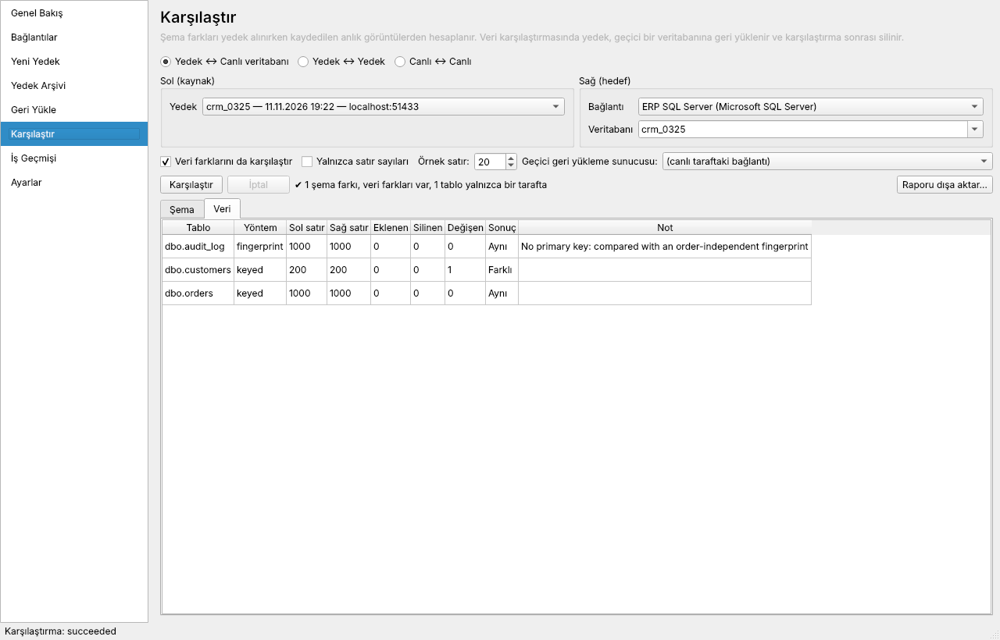

# dbnero

**MSSQL, MySQL ve PostgreSQL için çapraz platform masaüstü yedekleme, geri yükleme ve karşılaştırma uygulaması.**

dbnero farklı veritabanı sunucularına bağlanır; tekil veya toplu yedek alır, her veritabanını ayrı bir dosyaya yazar, yedekleri açıklama/etiket/tarih gibi meta verilerle arşivler, uygun yedekleri güvenli şekilde geri yükler ve yedekler ile canlı veritabanları arasındaki **şema ve veri farklarını** gösterir.

| | |
|---|---|
| **Platformlar** | Windows, macOS, Linux |
| **Dil / arayüz** | Python 3.12+, PySide6 (Qt) |
| **Veritabanları** | PostgreSQL 12+, MySQL 8.0+, SQL Server 2017+ |
| **Lisans** | MIT |



---

## Özellikler

**Bağlantılar**
- MSSQL, MySQL ve PostgreSQL için bağlantı profilleri; TLS/SSL seçenekleri, SQL Server için Windows kimlik doğrulaması
- Bağlantı testi, veritabanı keşfi (sistem veritabanları ayrı gösterilir), sunucu sürümü tespiti
- Parolalar işletim sisteminin anahtar kasasında (`keyring`) tutulur. Kasa yoksa parolalar yalnızca oturum boyunca bellekte kalır. Kataloğa, manifest'e, loglara veya komut satırı argümanlarına **hiçbir zaman** yazılmaz.

**Yedekleme**
- Tekil ve toplu yedek: **her veritabanı ayrı dosya + ayrı katalog kaydı**. Bir veritabanının hatası diğerlerini etkilemez.
- Açıklama, etiketler, isteğe bağlı referans tarihi. Gerçek oluşturma zamanı UTC olarak kaydedilir ve değiştirilemez.
- Yedek önce `.partial` dosyasına yazılır, SHA-256 hesaplandıktan sonra atomik olarak son adına taşınır.
- Yedek anında **şema anlık görüntüsü** alınır; yedeğin yanına taşınabilir bir `manifest.json` yazılır.
- Disk alanı kontrolü, eşzamanlılık sınırı, ilerleme göstergesi ve iptal.

**Arşiv**
- Tarih, motor, durum, etiket ve metne göre arama/filtreleme
- Yeniden doğrulama: boyut, SHA-256 ve motora özgü derin kontrol
- Meta veri düzenleme, onaylı silme, arşivi manifest dosyalarından kataloğa yeniden aktarma
- Onaylı saklama politikası: son N yedek ve/veya en fazla yaş. Her veritabanının en yeni başarılı yedeği her zaman korunur.

**Geri yükleme**
- Ön kontroller: motor eşleşmesi, sürüm uyumu, SHA-256, hedefin varlığı, gerekli araçlar
- Varsayılan hedef **yeni bir veritabanıdır**. Var olanın üzerine yazmak için kutucuğu işaretlemek **ve veritabanı adını yazmak** gerekir.
- Üzerine yazmadan önce isteğe bağlı koruyucu yedek
- Geri yükleme sonrası şema, yedeğin anlık görüntüsüyle karşılaştırılarak doğrulanır.

**Karşılaştırma**
- Yedek ↔ canlı, yedek ↔ yedek, canlı ↔ canlı
- Şema farkları: tablolar, sütunlar (tip/null/varsayılan), birincil/yabancı anahtarlar, indeksler, view/trigger/procedure/function
- Veri farkları: yedek geçici bir veritabanına geri yüklenir ve iş bitince silinir. Birincil anahtarlı tablolarda eklenen, silinen ve değişen satırlar; anahtarsız tablolarda parmak izi karşılaştırması yapılır.
- HTML / JSON / CSV rapor. Örnek satır verileri yalnızca açık onayla rapora eklenir.

**Diğer**
- Genel bakış panosu (son yedekler, başarısız işler, arşiv boyutu, disk doluluğu)
- İş geçmişi ve kalıcı iş günlükleri
- İlk çalıştırmada araç/sürücü/parola kasası kontrolü ve platforma özel kurulum talimatı

| Genel bakış | Geri yükleme | Karşılaştırma |
|---|---|---|
|  |  |  |

---

## Kurulum

### Hazır paket

[Actions → Build packages](../../actions/workflows/release.yml) iş akışı Windows (`.zip`), macOS (`.app`, imzasız) ve Linux (`.tar.gz`) paketleri üretir. Bir `v*` etiketi gönderildiğinde veya iş akışı elle çalıştırıldığında derlenir.

### Kaynaktan

```bash
git clone https://github.com/OguzcanOzdemir/Dbnero.git
cd Dbnero
python -m venv .venv
source .venv/bin/activate          # Windows: .venv\Scripts\activate
pip install -e ".[all]"            # tüm veritabanı sürücüleri
python -m dbnero                   # veya: dbnero
```

Yalnızca belirli motorlar için: `pip install -e ".[postgresql]"`, `".[mysql]"`, `".[mssql]"`.

### Harici araçlar

dbnero motorların kendi araçlarını kullanır; bu araçlar uygulamayla birlikte gelmez:

| Motor | Gerekli | Örnek kurulum |
|---|---|---|
| PostgreSQL | `pg_dump`, `pg_restore` (sunucu sürümüne eşit veya daha yeni) | `apt install postgresql-client` · `brew install libpq` |
| MySQL | `mysqldump`, `mysql` | `apt install mysql-client` · `brew install mysql-client` |
| SQL Server | Microsoft ODBC Driver 17/18 | [Microsoft belgeleri](https://learn.microsoft.com/sql/connect/odbc/download-odbc-driver-for-sql-server) |

Araçlar PATH'te değilse yollarını **Ayarlar** ekranından gösterin. Ayrıntılar ve sınırlamalar: [docs/backup-compatibility.md](docs/backup-compatibility.md).

### SQL Server notu

`BACKUP DATABASE` dosyayı SQL Server'ın kendi diskine yazar. Bağlantıda **Sunucu yedek klasörü** (sunucunun gördüğü yol) ve **Yerel erişim yolu** (aynı klasörün bu bilgisayardaki paylaşım yolu) tanımlanırsa yedek arşive kopyalanır ve geri yükleme bu yolla yapılır. Paylaşım yoksa dosya T-SQL `OPENROWSET` ile aktarılır.

---

## Arşiv düzeni

```
<arşiv>/<motor>/<sunucu>/<veritabanı>/<yıl>/<ay>/
    2026-11-11_204000_postgresql_crm_7b9cde3d.dump
    2026-11-11_204000_postgresql_crm_7b9cde3d.manifest.json
    2026-11-11_204000_postgresql_crm_7b9cde3d.schema.json
```

Varsayılan arşiv ve katalog konumu işletim sisteminin kullanıcı veri klasörüdür (ör. Linux'ta `~/.local/share/dbnero`). Arşiv klasörü Ayarlar ekranından değiştirilebilir. Katalog kaybolursa **Yedek Arşivi → Arşivden içe aktar** manifest dosyalarından kayıtları geri yükler.

---

## Mimari

```
ui/ (PySide6)  ──►  core/ (servisler, iş yöneticisi)  ──►  adapters/ (PostgreSQL, MySQL, MSSQL)
                                                     ├──►  storage/ (SQLite katalog, arşiv, manifest)
                                                     └──►  compare/ (şema/veri diff, raporlar)
```

Ayrıntılar: [docs/architecture.md](docs/architecture.md). Geliştirme kuralları: [CLAUDE.md](CLAUDE.md).

---

## Geliştirme

```bash
pip install -e ".[dev,all]"
ruff check . && ruff format --check . && mypy
pytest tests/unit                      # hızlı, harici veritabanı gerekmez

# Entegrasyon testleri (gerçek PostgreSQL, MySQL, SQL Server)
mkdir -p .mssql-share && chmod 777 .mssql-share
docker compose -f docker-compose.test.yml up -d --wait
pytest tests/integration
```

Linux'ta Qt için `libegl1 libgl1 libxkbcommon0 libfontconfig1 libdbus-1-3` gerekir. Başsız ortamda `QT_QPA_PLATFORM=offscreen` kullanın.

Paket derleme: `pip install -e ".[all,packaging]" && pyinstaller packaging/dbnero.spec`

---

## Kapsam dışı

- Motorlar arası veri taşıma/dönüştürme
- Zamanlanmış (otomatik) yedekleme ve bulut depolama
- Şifreli arşiv, merkezi/ekip yönetimi
- PostgreSQL global nesneleri, MySQL fiziksel yedek

Yol haritası ve durum: [TASKS.md](TASKS.md).
