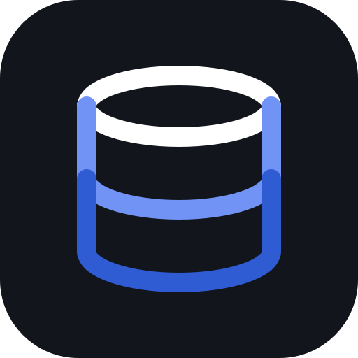
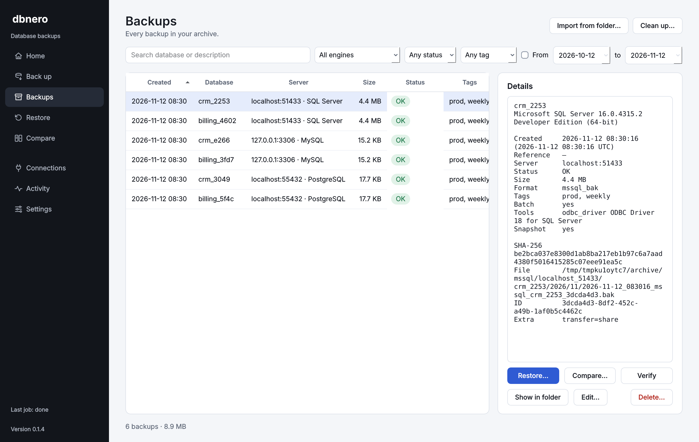
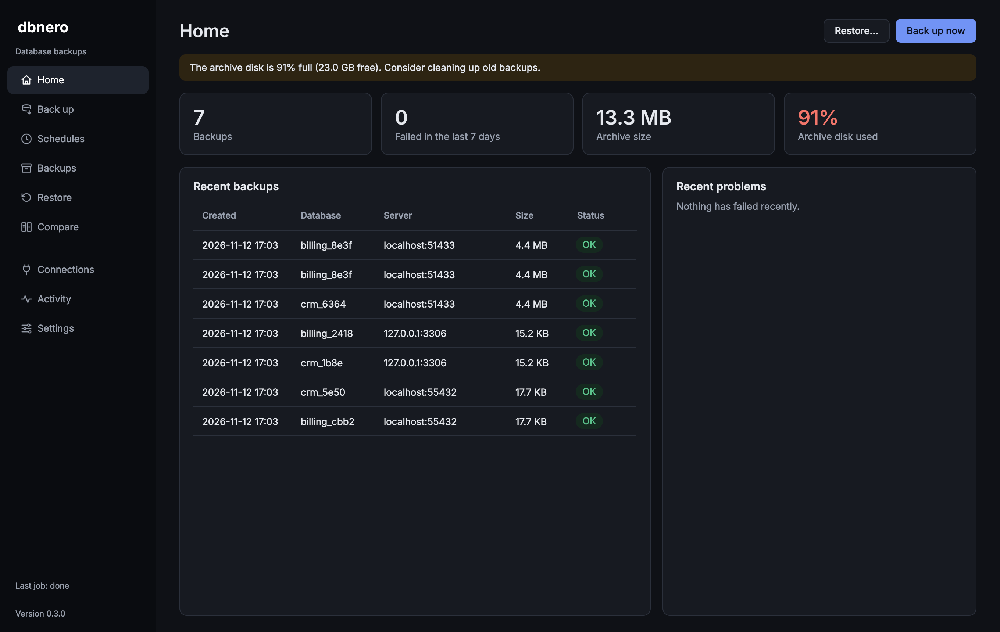
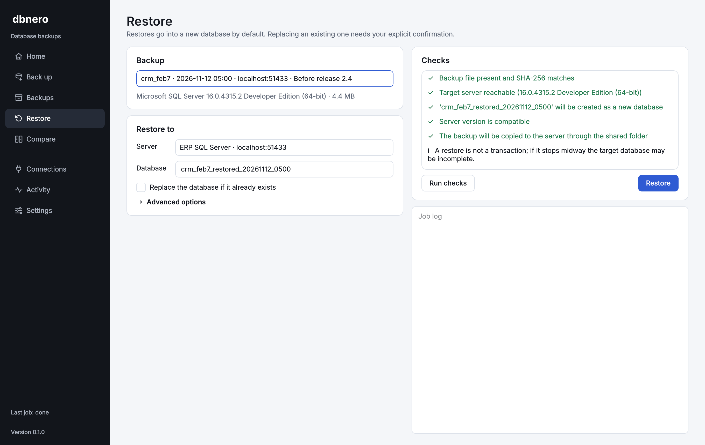
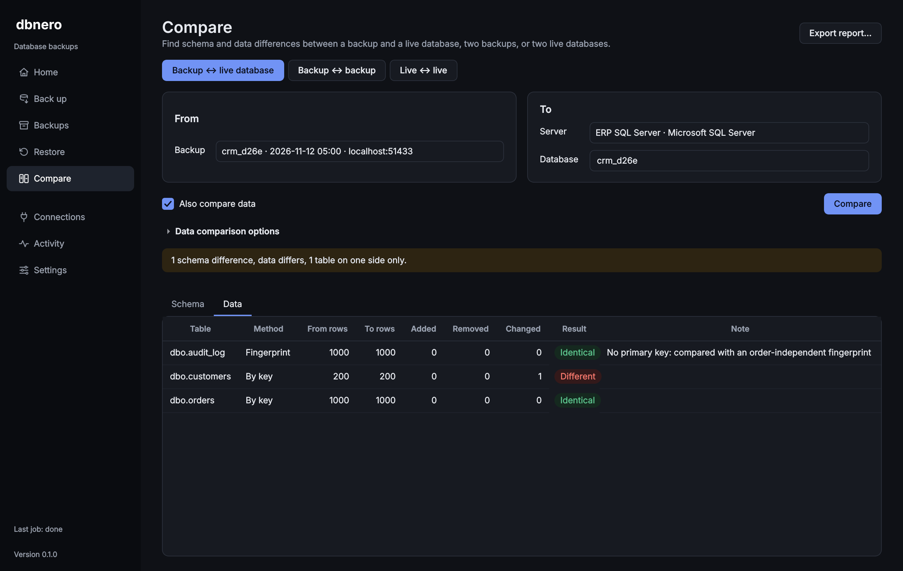

<p align="center"></p>

<h1 align="center">dbnero</h1>

<p align="center"><b>Back up, restore and compare PostgreSQL, MySQL and SQL Server databases.</b><br>
Free desktop app for Windows, macOS and Linux.</p>

<p align="center">
  <a href="https://oguzcanozdemir.github.io/Dbnero/"><b>Website</b></a> ·
  <a href="https://github.com/OguzcanOzdemir/Dbnero/releases/latest"><b>Download</b></a> ·
  <a href="docs/backup-compatibility.md">Compatibility</a>
</p>



## Download

| System | File |
|---|---|
| **Windows** 10/11, 64-bit | [Installer (.exe)](https://github.com/OguzcanOzdemir/Dbnero/releases/latest/download/dbnero-windows-x64-setup.exe) · [Portable (.zip)](https://github.com/OguzcanOzdemir/Dbnero/releases/latest/download/dbnero-windows-x64-portable.zip) |
| **macOS** 11+, Apple Silicon | [Disk image (.dmg)](https://github.com/OguzcanOzdemir/Dbnero/releases/latest/download/dbnero-macos-arm64.dmg) |
| **Linux** x86-64 | [AppImage](https://github.com/OguzcanOzdemir/Dbnero/releases/latest/download/dbnero-linux-x86_64.AppImage) · [Archive (.tar.gz)](https://github.com/OguzcanOzdemir/Dbnero/releases/latest/download/dbnero-linux-x86_64.tar.gz) |

Checksums are in [`SHA256SUMS.txt`](https://github.com/OguzcanOzdemir/Dbnero/releases/latest/download/SHA256SUMS.txt) on every release.

The builds are not code-signed yet:
- **Windows:** if SmartScreen appears, choose *More info → Run anyway*.
- **macOS:** right-click the app and choose *Open* the first time.
- **Linux:** run `chmod +x` on the AppImage, then start it.

### Database tools

Nothing extra to install for PostgreSQL and MySQL: `pg_dump`, `pg_restore`, `mysqldump` and `mysql` ship inside the app. A tool path set in **Settings**, or a newer copy on your PATH, is used instead when needed (for example a PostgreSQL server newer than the bundled `pg_dump`).

SQL Server uses an ODBC driver. Windows already includes one. On macOS and Linux install [Microsoft ODBC Driver 18](https://learn.microsoft.com/sql/connect/odbc/download-odbc-driver-for-sql-server) if you back up SQL Server.

## What it does

- **Back up** one database or many. Each database gets its own file and archive entry, and one failure never hides the others.
- **Schedules:** back up automatically every day, on chosen days or every few hours, and keep only the last N backups per database. They also run while dbnero is closed (Windows Task Scheduler, macOS launchd or a systemd user timer start it briefly); missed runs catch up when the computer is back on, and dbnero tells you about missed or failed backups the next time you open it.
- **Never half-written:** backups go to a temporary file, are verified with the engine's tools, then moved into place with a SHA-256 checksum, a schema snapshot and a `manifest.json`.
- **Restore safely:** pick the database to restore into or type a new name. Replacing an existing database needs an explicit confirmation, takes a safety backup first and compares the restored schema with the backup.
- **Compare** a backup with a live database, two backups or two live databases. Schema differences cover tables, columns, keys, indexes, views, triggers and routines. Data differences are row-level by primary key, using a temporary restore.
- **Reports** in HTML, JSON or CSV. Sample rows are included only if you agree.
- **Passwords** are saved in the system keychain (untick "Save password" to keep one only until dbnero closes), never in the catalog, logs or command lines. If Windows refuses keychain access, they are saved encrypted for your Windows user instead.
- **Portable archive:** plain files with manifests. If the catalog is lost, *Import from folder* rebuilds it.
- **Light and dark themes** that follow your system.

| Home | Restore | Compare |
|---|---|---|
|  |  |  |

### Engines

| Engine | Backup | Restore | File | Server versions |
|---|---|---|---|---|
| PostgreSQL | `pg_dump --format=custom` | `pg_restore` | `.dump` | 12+ |
| MySQL | `mysqldump --single-transaction` | `mysql` | `.sql.gz` | 8.0+ |
| SQL Server | `BACKUP DATABASE … WITH CHECKSUM` | `RESTORE DATABASE … WITH MOVE` | `.bak` | 2017+ |

**SQL Server note:** `BACKUP DATABASE` writes to the server's own disk. Set *Server backup folder* and its *local path* (for example `\\server\Backups`) on the connection so backups can be copied into the archive and restored. Without a share, dbnero transfers the file through SQL (`OPENROWSET`).

### Archive layout

```
<archive>/<engine>/<server>/<database>/<year>/<month>/
    2026-11-11_204000_postgresql_crm_7b9cde3d.dump
    2026-11-11_204000_postgresql_crm_7b9cde3d.manifest.json
    2026-11-11_204000_postgresql_crm_7b9cde3d.schema.json
```

## Run from source

```bash
git clone https://github.com/OguzcanOzdemir/Dbnero.git
cd Dbnero
python -m venv .venv && source .venv/bin/activate   # Windows: .venv\Scripts\activate
pip install -e ".[all]"
python -m dbnero
```

## Development

```bash
pip install -e ".[dev,all]"
ruff check . && ruff format --check . && mypy
pytest tests/unit

# Integration tests against real PostgreSQL, MySQL and SQL Server
mkdir -p .mssql-share && chmod 777 .mssql-share
docker compose -f docker-compose.test.yml up -d --wait
pytest tests/integration
```

On Linux, Qt needs `libegl1 libgl1 libxkbcommon0 libfontconfig1 libdbus-1-3`. For headless runs use `QT_QPA_PLATFORM=offscreen`.

- **Build packages locally:** `pip install -e ".[all,packaging]" && pyinstaller packaging/dbnero.spec`
- **Release:** push a tag such as `v0.1.0`. The [Release workflow](.github/workflows/release.yml) builds every installer and publishes a GitHub Release.
- **Website:** the [Website workflow](.github/workflows/pages.yml) publishes `site/` to GitHub Pages.

Architecture notes: [docs/architecture.md](docs/architecture.md) · Project rules: [CLAUDE.md](CLAUDE.md) · Roadmap: [TASKS.md](TASKS.md)

## Not included

- Cross-engine migration (for example SQL Server → MySQL)
- Cloud storage
- Encrypted archives, team or central management
- PostgreSQL global objects, MySQL physical backups

## Terms and privacy

dbnero asks you to accept its [Terms of Use](https://oguzcanozdemir.github.io/Dbnero/terms.html) and [Privacy Policy](https://oguzcanozdemir.github.io/Dbnero/privacy.html) once, on first start. In short: it is provided without warranty, you are responsible for checking your backups, and it collects no data at all.

## License

MIT
